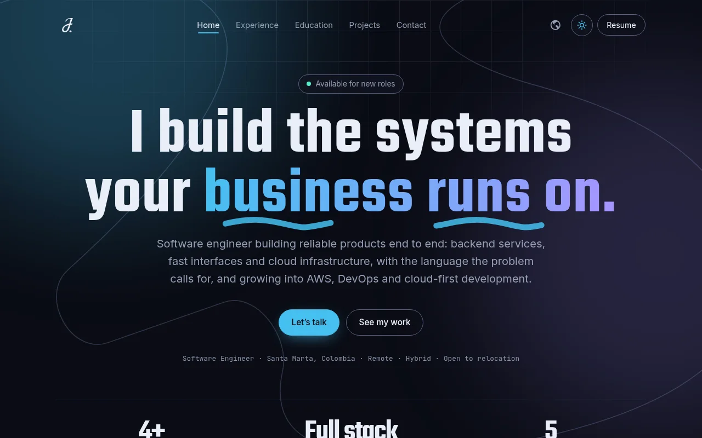
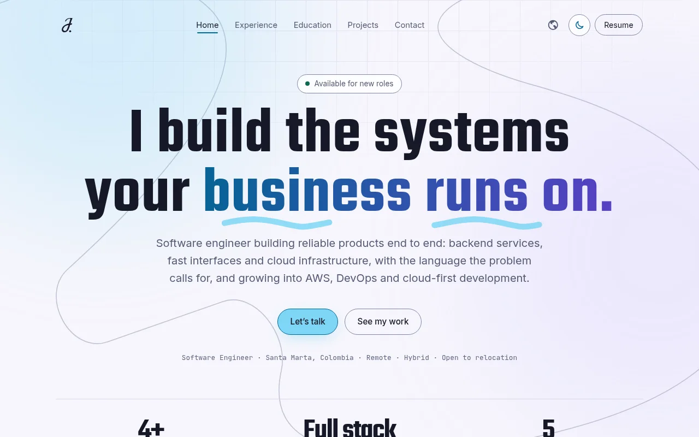
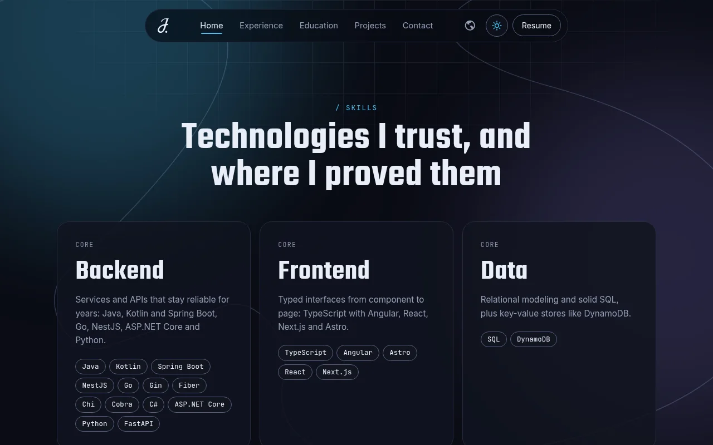
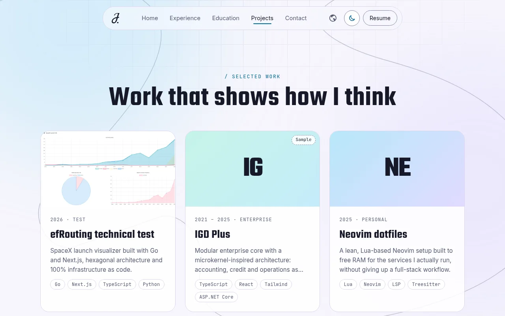
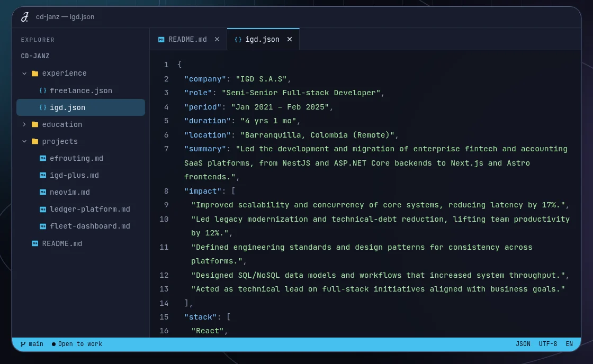
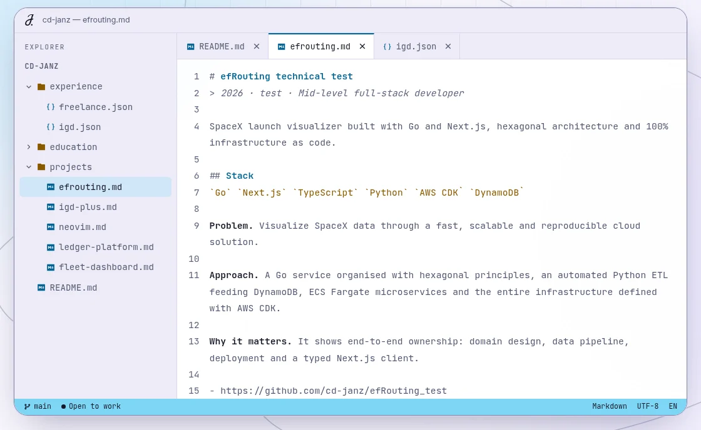
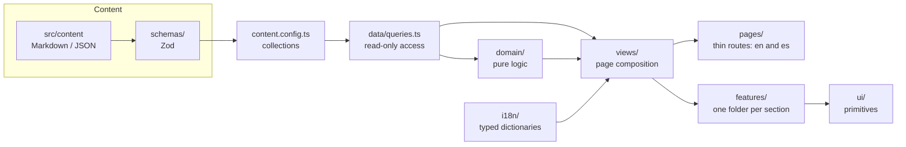
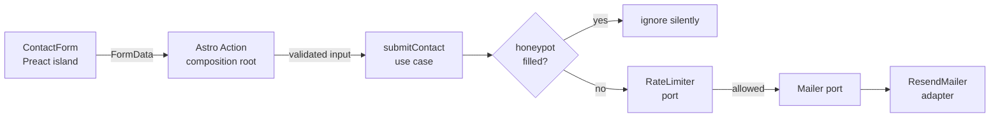

<div align="center">

# Juan Camilo Zúñiga — Portfolio

**A fast, accessible and bilingual developer portfolio, built as a small system rather than a template.**

[](https://astro.build)
[](https://preactjs.com)
[](https://www.typescriptlang.org)
[](https://sass-lang.com)
[](https://vitest.dev)
[](#measured-quality)
[](https://github.com/janzsh/portfolio/actions/workflows/ci.yml)
[](LICENSE)

<br />




</div>

---

## Highlights

- **Zero-JS by default.** Almost everything is static Astro HTML. The only hydrated piece is the contact form; the header, theme switch and project dialogs use tiny vanilla scripts.
- **Two themes, one source of truth.** Pastel light and neon dark, following `prefers-color-scheme` with a manual switch that persists and never flashes the wrong theme.
- **Bilingual from the routing up.** English at `/`, Spanish at `/es/`, with `hreflang`, localized canonical URLs and a language switch that stays on the same page.
- **Content as data.** Every section is Markdown or JSON in Astro content collections, validated by Zod at build time. A typo in a date fails the build instead of the page.
- **Accessibility is measured, not claimed.** WCAG 2.2 AA checked with axe-core across every page, theme and viewport, plus keyboard, focus and reduced-motion handling.
- **A contact form that does not leak.** Hexagonal server code (ports and adapters), honeypot, rate limiting and escaped emails. No email address or phone number is published anywhere in the HTML.
- **The career as a codebase.** An interactive, VS Code-style explorer built from the same content: open `experience/*.json`, `projects/*.md` or the README in tabs, with syntax highlighting that works in both themes. It is a lazy Preact island of ~4.5 KB gzip that never loads on small screens.
- **Printable résumé.** `/resume` is a paper-style page that always uses the light palette and prints to a clean two-page PDF.

<div align="center">


</div>

### The career as a codebase

The `Under the hood` section is a small VS Code-style workspace generated from the same content files. Folders and tabs behave like the real thing, and the syntax colors are part of the theme palette, so they stay legible in both modes.

<div align="center">


</div>

## Measured quality

Measured on a local static production build served with gzip, home page with the IDE section included. The key thresholds are enforced in CI on every pull request.

| Check | Result |
| --- | --- |
| Lighthouse (mobile and desktop) | **100** performance · **100** accessibility · **100** best practices · **100** SEO |
| Core Web Vitals (lab) | LCP **0.8 s** mobile · CLS **0** · TBT **0 ms** |
| axe-core, WCAG 2.0/2.1/2.2 A + AA + best practices | **0 violations** in 36 runs (9 pages × light/dark × desktop/mobile), plus 8 more on the home page with the IDE hydrated and in use |
| Weight of the home page | ~140 KiB over 8 requests, including three fonts |
| Unit tests | 80+ passing |

The audit found and fixed real issues along the way: a 0.12 layout shift caused by web fonts swapping under the headline (fixed with a latin-only subset and preload), duplicate meta descriptions, and a missing focus move on form errors, and an ARIA `tablist` in the IDE that illegally contained close buttons (replaced by a plain list of open files).

## Tech stack

| Layer | Choice | Why |
| --- | --- | --- |
| Framework | [Astro](https://astro.build) (static output) | Ships HTML, hydrates only what needs it |
| Interactivity | [Preact](https://preactjs.com) + [`@preact/signals`](https://preactjs.com/guide/v10/signals/) | Tiny runtime for the few islands |
| Styles | SCSS with [BEM](https://getbem.com), CSS custom properties | Predictable, themeable, no utility-class sprawl |
| Content | Astro content collections (Markdown + JSON) | Typed content with no CMS |
| Validation | [Zod](https://zod.dev) | One schema per content type and for the form |
| Email | [Resend](https://resend.com) behind a `Mailer` port | Swappable provider |
| Tests | [Vitest](https://vitest.dev) | Fast, works with Astro's Vite config |
| Package manager | [pnpm](https://pnpm.io) | Install scripts denied by default |
| Hosting | [Vercel](https://vercel.com) | Static pages plus one serverless action |
| Dev environment | [Nix flake](flake.nix) (optional) | Reproducible Node, pnpm and Chromium |

## Architecture

Content flows one way, from files to pages. Pages never read collections directly and UI copy never lives in components.



The contact flow is the only part with a server, and it follows ports and adapters so the use case knows nothing about Resend or Astro:



### Project structure

```text
src/
  actions/      composition root wiring the contact use case into an Astro Action
  assets/       SVG icons, brand marks and decorations, profile photo
  config/       site-wide constants only
  content/      <collection>/<locale>/<entry> as Markdown or JSON
  data/         read-only queries over the collections
  domain/       pure TypeScript: dates, timeline sorting, skill grouping
  features/     one folder per section: hero, about, skills, experience,
                education, projects, ide, contact, resume, header, footer, seo
  i18n/         locales, path helpers and typed UI dictionaries
  layouts/      Head, Fonts, BaseLayout (site chrome) and DocumentLayout
  pages/        thin routes: <View locale="..." />
  schemas/      one Zod schema per content type
  scripts/      small, tested browser helpers (theme)
  server/       contact use case, ports, adapters, templates
  styles/       abstracts (themes, tokens, mixins), base and shared blocks
  ui/           primitives: Button, Tag, Icon, Section, PageHeader, ThemeToggle
  views/        page-level composition shared by every locale
```

## Design system

Colors are stored as **bare RGB channel triplets**, so one token works both opaque and translucent:

```scss
// abstracts/_palettes.scss
'bg': '247, 246, 252',

// anywhere
background: rgb(var(--color-bg));
border-color: rgba(var(--color-fg), 0.12);
```

- **Themes live in one file.** Light is the base; dark applies through `prefers-color-scheme` *and* `[data-theme="dark"]`, and an explicit light choice beats the OS.
- **Accent fill and accent text are separate tokens.** Pastel fills are too pale to read as text on a light page, so text and focus rings use a deeper `-text` tone. In dark they are the same neon.
- **BEM everywhere.** `.block`, `.block__element`, `.block--modifier`, with shared patterns promoted to mixins (breakpoints, focus ring, eyebrow label) instead of copied.
- **Motion is opt-in.** Animations run only under `prefers-reduced-motion: no-preference`, and content never depends on them to be visible.

## Getting started

Requirements: Node 24 and pnpm. With [Nix](https://nixos.org) you get both, plus Chromium for browser checks:

```bash
nix develop          # optional: Node, pnpm, Chromium, agent-browser
pnpm install
cp .env.example .env # RESEND_API_KEY, CONTACT_TO_EMAIL, CONTACT_FROM_EMAIL
pnpm dev
```

| Command | What it does |
| --- | --- |
| `pnpm dev` | Dev server with hot reload |
| `pnpm build` | Production build (static pages + serverless action) |
| `pnpm test` | Run the Vitest suite once |
| `pnpm test:watch` | Tests in watch mode |
| `pnpm check` | `astro sync` + strict `tsc --noEmit` |
| `pnpm verify` | Types, tests and build in one go |
| `pnpm audit:web` | axe-core + Lighthouse against the last build (run `pnpm build` first) |
| `pnpm og` | Regenerate `public/og.png` (run it inside `nix develop`) |

## Testing

The project is developed test-first for its logic: pure modules (dates, skill grouping, headline splitting, theme resolution, JSON-LD, contact use case, rate limiter, email template, the IDE's virtual repository, syntax highlighter and state) have unit tests, and the contact form's action client is the only thing mocked, because it is a network boundary. Visual and interactive behavior is checked in a real browser.

## Deployment

Deployed to Vercel. Set these environment variables in the project settings:

| Variable | Purpose |
| --- | --- |
| `RESEND_API_KEY` | Resend API key (secret) |
| `CONTACT_TO_EMAIL` | Where contact messages are delivered (secret) |
| `CONTACT_FROM_EMAIL` | Sender address, defaults to Resend's onboarding sender |

The in-memory rate limiter is per serverless instance. It is a best-effort guard; swap the `RateLimiter` implementation (for example with Upstash) for strict limits without touching the use case.

## Built with AI assistance

This project was built with [Claude Code](https://claude.com/claude-code). The conventions it follows (stack, SCSS/BEM rules, theming, testing and engineering principles) are written down in [`CLAUDE.md`](CLAUDE.md), and the third-party agent skills it uses live in [`.claude/skills`](.claude/skills).

## Continuous integration

GitHub Actions runs [one workflow](.github/workflows/ci.yml) with two tiers of checks:

| When | What runs |
| --- | --- |
| Push to `develop` | Strict type-check, the Vitest suite and the production build (`pnpm verify`) |
| Pull request, or push to `main` | All of the above, plus an accessibility and performance audit of the build (`pnpm audit:web`) |

The audit reuses the build that `verify` just made and takes about a minute: axe-core runs over every page in both themes (desktop, a sample on mobile, and the IDE after opening a file), then Lighthouse runs three times. It fails on any axe violation, on a Lighthouse accessibility or SEO score below 100, on performance or best practices below 90, or on layout shift above 0.1. A table with the scores lands in the run summary.

You can run the same audit locally after a build: `pnpm build && pnpm audit:web`.

## Credits

Visual design by [**RZOR**](https://yefersonruzon.vercel.app/). Built by [janzsh](https://github.com/janzsh).

## Roadmap

- [ ] Follow the manual theme in `theme-color`

## License

The **source code** is released under the [MIT License](LICENSE).

The **content and visual identity** (texts, profile photo, brand marks, decorations and Open Graph image) are © Juan Camilo Zúñiga, all rights reserved. See [LICENSE-CONTENT.md](LICENSE-CONTENT.md). If you fork this to build your own site, please replace them with yours.
